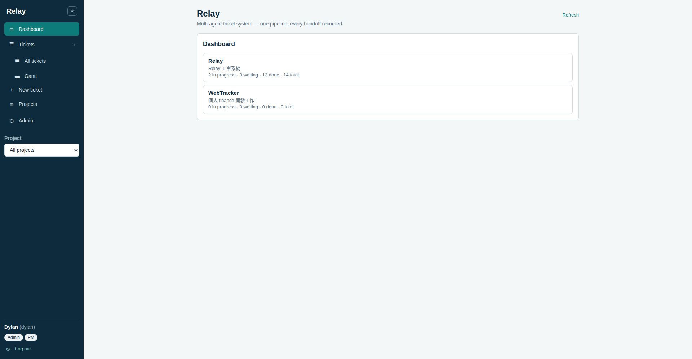
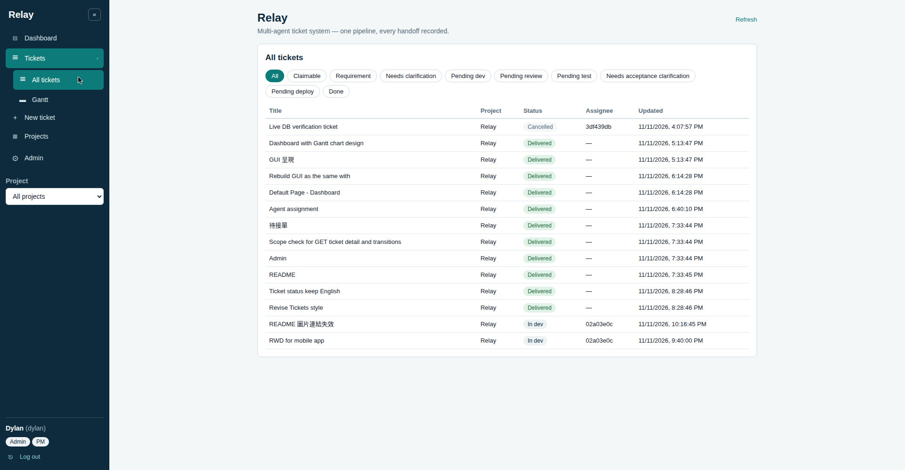
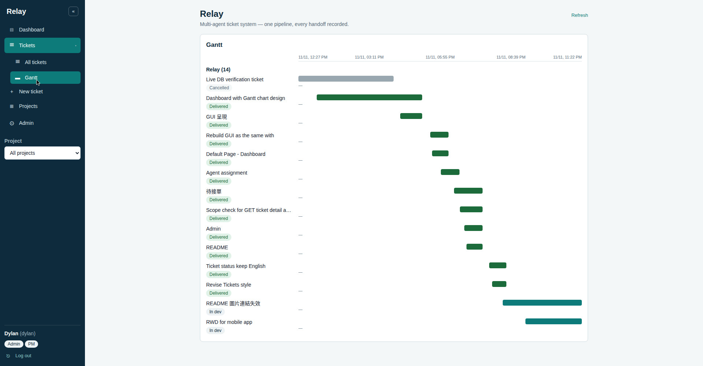
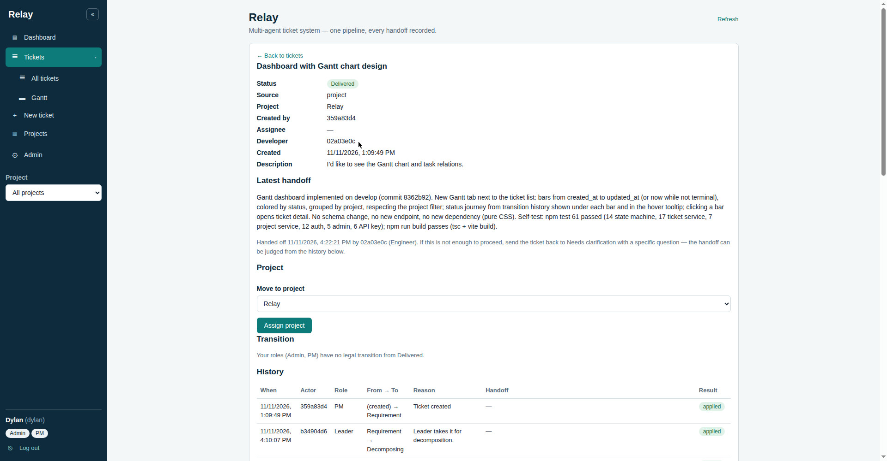
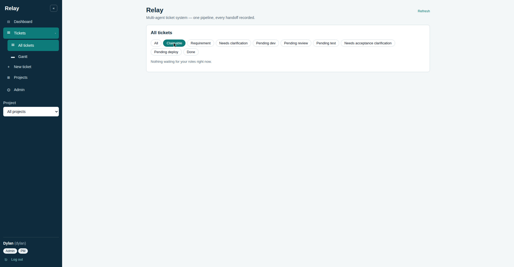
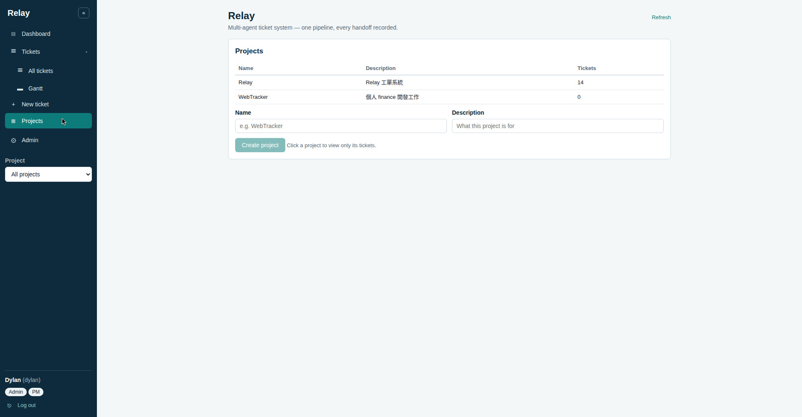
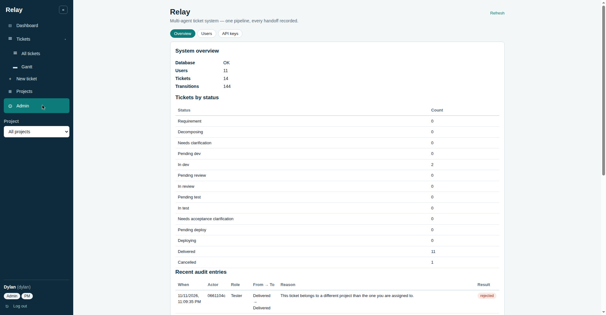

# Relay

A multi-agent ticket system. Work flows through one pipeline as tickets: a PM
opens a requirement, a Leader breaks it down, an engineer builds it, and it
passes through review, testing and deployment until delivery. Every agent
(and every person) only picks up tickets in its own queue, hands off by
changing the ticket's state, and every state change is recorded so the whole
history can be replayed.

The app is a single-page app with a left sidebar: Dashboard is the default
page, and Tickets, New ticket, Projects and Admin are one click away (see
[Layout](#layout)).

Design document (Traditional Chinese): [doc/design.md](doc/design.md).
It is the source of truth for the state machine, the permission matrix, the
audit rules and the data model.

## Screenshots

The screenshots below are placeholders for now — they must be real
screenshots of the running app, not mockups. Capture them from the deployed
app after this branch is released (the live site still runs an older build,
so screenshots taken now would not match the current UI). See
[screenshots/README.md](screenshots/README.md) for the capture list.















## Locked design (2026-11-11)

- **Pipeline states (14):** `requirement` → `decomposing` (with a
  `needs_clarification` loop) → `pending_dev` → `in_dev` →
  `pending_review` → `in_review` → `pending_test` → `in_test` →
  `pending_deploy` → `deploying` → `delivered`; `cancelled` is the other
  terminal state. Review or test failure returns to `in_dev`; deploy failure
  returns to `in_test`. A tester who cannot judge acceptance asks the PM
  instead of returning the ticket to development: `in_test` →
  `needs_acceptance_clarification` → `in_test`, with a required reason
  each way, and the ticket stays in the testing stage throughout.
- **Who may transition what (20 legal transitions):** PM, Leader, Engineer,
  Reviewer, Tester and Deployer each own their own transitions. Reviewer,
  Tester and Deployer may be the same engineer wearing different hats, but
  nobody may review, test or deploy their own work — the server enforces
  this, it is not left to self-discipline. The PM may cancel a ticket
  from any non-terminal state (reason required); that is the 20th
  transition.
- **Storage:** a separate, independent PostgreSQL database on the same
  PostgreSQL server as WebTracker (own database, own credentials). No Jira,
  no shared tables with WebTracker.
- **Audit:** every transition records who, when, from which state, to which
  state, and why, plus attached output. History is append-only; rejected
  transition attempts are logged too.
- **Accounts & authentication (locked 2026-11-11):** every caller logs in
  as an account that holds one or more roles (`pm`, `leader`, `engineer`,
  `reviewer`, `tester`, `deployer`, `admin`). Passwords are hashed with
  scrypt and a per-user salt; sessions are opaque bearer tokens valid for
  7 days. There is no pre-seeded account: the first admin is created
  through first-run setup, which closes permanently once any account
  exists. Admin accounts manage users and see the full system overview,
  but admin does not bypass the workflow role checks on transitions. See
  [Accounts & authentication](#accounts--authentication) and design doc
  ch. 11.
- **Agent access (locked 2026-11-11, Phase 2):** agent processes
  authenticate with long-lived API keys (`rl_…`, `X-API-Key` header)
  issued per account by an admin; a key inherits its account's roles and
  is subject to the same role and self-work checks as a session. Keys are
  revocable and only a scrypt hash is stored — the full key is shown
  exactly once, at creation. `GET /api/queue` lists the tickets the
  caller's roles can claim in the trial stages (decomposing and
  development). The two trial handoffs (`decomposing` → `pending_dev`,
  `in_dev` → `pending_review`) require a handoff note describing what was
  produced for the next role; the note is stored on the audit row, and the
  next role can send the ticket back to `needs_clarification` when it is
  not enough. See [Agent access](#agent-access) and design doc ch. 12.
- **Agent assignment (2026-11-11):** an admin may assign an agent
  account to a single project. An assigned account's claim queue and
  ticket list only return that project's tickets, and transitions on
  other projects' tickets are rejected server-side (403
  `out_of_scope`, audited). The ticket detail and transition history
  endpoints enforce the same scope (2026-11-11, ticket 8d030ed9):
  reading another project's ticket returns 403 `out_of_scope`,
  audited as a rejected read. An unassigned account (no project assigned)
  keeps the current behavior and sees all projects. One project per
  agent in v1; multi-project assignment is out of scope. See
  [Agent access](#agent-access) and design doc ch. 11–12.

## Project structure

```
relay/
├── src/                  # React + TypeScript + Vite frontend
│   ├── main.tsx
│   ├── App.tsx           # sidebar layout, module views, auth screens
│   ├── api.ts            # typed API client (session + API key)
│   ├── helpers.ts        # labels, queue tabs, status buckets
│   ├── Dashboard.tsx     # default page: project overview
│   ├── TicketList.tsx    # All tickets list + claimable queue
│   ├── TicketGantt.tsx   # Gantt timeline, grouped by project
│   ├── TicketDetail.tsx  # ticket detail view with transition history
│   ├── NewTicketForm.tsx # create-ticket form
│   ├── ProjectsPanel.tsx # project list / create project
│   ├── AdminPanel.tsx    # Admin shell: Overview / Users / API keys tabs
│   ├── AdminOverview.tsx # system overview, tickets by status, audit
│   ├── AdminUsers.tsx    # user list, create/edit, assign project, reset password
│   ├── AdminApiKeys.tsx  # per-user API key management
│   └── index.css
├── server/               # Express backend (Node.js)
│   ├── index.js          # entry point, API routes
│   ├── database.js       # pg Pool, auto-creates tables on startup
│   ├── stateMachine.js   # 14 states, 20 legal transitions, role checks
│   ├── tickets.js        # ticket service: create / transition / history / claim queue
│   ├── projects.js       # project service
│   ├── auth.js           # users, scrypt passwords, sessions, API keys, auth middleware
│   ├── admin.js          # admin overview aggregation, project assignment
│   ├── stateMachine.test.js
│   ├── tickets.test.js
│   ├── projects.test.js
│   ├── auth.test.js
│   ├── admin.test.js
│   └── apikeys.test.js
├── db/
│   └── migrations/       # schema as SQL migrations (001-008)
├── doc/
│   └── design.md         # design document (Traditional Chinese)
├── screenshots/          # README screenshots (see screenshots/README.md)
├── index.html
├── vite.config.ts
├── tsconfig.json
├── package.json
├── Startup.sh / Startup.bat
└── LICENSE
```

## Quickstart

```bash
cp .env.example .env   # fill in the PostgreSQL connection for the relay database
npm install
npm run dev            # frontend on http://localhost:8090, backend on :8890
```

Or use `./Startup.sh` (Linux/macOS) / `Startup.bat` (Windows), which frees
the frontend and backend ports and then starts the same dev servers.

The backend needs a PostgreSQL database (default name `relay`, see
`.env.example`). Creating that database is a separate deployment step and is
not done by the code in this repo; the server creates the `tickets`,
`ticket_transitions`, `users`, `sessions`, `api_keys` and `projects` tables
itself on startup (migrations `db/migrations/001-008`).

On first run the users table is empty, so the app shows a setup screen:
create the first admin account there (username, display name, password).
Setup closes permanently once any account exists — there is no default
account or password anywhere in the code.

## Deployment

- **Ports** are configurable through `.env`: `FRONTEND_PORT` (default
  8090) and `BACKEND_PORT` (default 8890). In development the Vite dev
  server proxies `/api` to the backend, so the frontend and the API share
  one origin.
- **Build** the frontend with `npm run build` (`tsc` + `vite build`,
  output in `dist/`); start the backend with `node server/index.js`
  (or `nodemon` in development via `npm run dev`). The backend reads
  `DB_HOST`, `DB_ACCOUNT`, `DB_PASSWORD` and `DB_NAME` from `.env`
  (`.env` is git-ignored and never committed).
- **Timezone:** the server defaults to `America/Phoenix` (`TZ` in `.env`).

## Layout

- **Left sidebar:** a dark sidebar holds the module navigation —
  Dashboard, Tickets, New ticket, Projects (PM or Admin only) and Admin
  (admin only) — plus a project filter, the signed-in user's name,
  username and role badges, and Log out. Tickets is an expandable group
  with two sub-pages, All tickets and Gantt; the group stays active on
  either sub-page and while a ticket detail is open. The active module is
  highlighted. A collapse toggle shrinks the sidebar to a 60px icon rail;
  on narrow screens (≤720px) the sidebar is hidden by default and opens
  as an overlay drawer from a hamburger button (tap the scrim or the
  close button to dismiss it). On mobile the ticket list becomes cards,
  the Gantt timeline scrolls horizontally with a sticky label column,
  and detail pages and forms stack in a single column.
- **Module views:** one module is shown at a time. The Dashboard is the
  default view; Tickets holds the ticket list (All tickets sub-page, with
  the Claimable queue tab and the project filter) and the Gantt timeline
  (Gantt sub-page), and the ticket creation entry; New ticket is the
  create form; Projects is the project list; Admin is the admin area (see [Admin](#admin)).
- **Ticket detail is its own view:** clicking a ticket (from the list, a
  Gantt bar or the claimable queue) opens the detail view with its full
  transition history and handoff notes; a back link returns to the
  Tickets sub-page it came from.

## Tests

```bash
npm test
```

Tests run with plain Node (`node:assert/strict`, no test framework) and do
not need a live database: the state machine is tested directly, and the
ticket service is tested against an in-memory fake implementing the same
`query()` interface as the real `pg` pool.

## Accounts & authentication

- **Accounts:** one account, one username (case-insensitive, unique), a
  display name, and one or more roles. Roles are `pm`, `leader`,
  `engineer`, `reviewer`, `tester`, `deployer`, plus `admin` for account
  management. An account may hold several roles at once — for example
  `engineer` + `reviewer`, matching the design doc's rule that one person
  may wear several hats but never review, test or deploy their own work.
  Deactivated accounts cannot log in, and their sessions stop working
  immediately.
- **Passwords:** hashed with Node's built-in `crypto.scrypt` and a
  per-user random salt (`scrypt$<salt>$<hash>`); no hashing dependency.
  Minimum 8 characters. Only hashes are stored, never plaintext.
- **Sessions:** `POST /api/auth/login` returns an opaque bearer token
  valid for 7 days. The client sends `Authorization: Bearer <token>`; the
  server checks the token, its expiry, and the account's active flag on
  every request. `POST /api/auth/logout` deletes the session.
  `GET /api/auth/me` returns the current account and its roles.
- **First-run setup:** `GET /api/auth/status` reports
  `{ "setup_required": true }` while the users table is empty. Then
  `POST /api/auth/setup` creates the first admin (roles `admin` + `pm`,
  so the account can open tickets immediately). Once any account exists,
  setup returns 403.
- **Admin:** accounts holding the `admin` role manage users and API keys
  from the Admin area (see [Admin](#admin)) and view the system
  overview (`GET /api/admin/overview`: user count and list without
  password hashes, ticket counts by status, total transition count, the
  10 most recent audit entries, database health). The last active admin
  cannot be deactivated or stripped of the admin role. Admin does **not**
  bypass workflow role checks: to move a ticket, the admin's account must
  hold the role that transition requires, like anyone else.

## Agent access

- **API keys:** an admin issues a key for an account from the Admin
  panel (per account: list, create, revoke). A key looks like
  `rl_` + 32 random hex characters and is sent as the `X-API-Key`
  header. Only a scrypt hash of the key is stored; the full key is shown
  exactly once, when it is created, and is never logged. A key inherits
  its account's roles and is subject to exactly the same role checks,
  self-work check and audit rules as a password session — including the
  rule that a key cannot use admin endpoints unless its account holds the
  `admin` role. Revoking a key (or deactivating its account) makes it
  stop working immediately. Last use is recorded per key.
- **Claim queue:** `GET /api/queue` returns the tickets the caller can
  currently pick up, each with the transition they would take next. The
  trial covers decomposing and development only: a ticket in
  `requirement` waits for a leader, a ticket in `pending_dev` waits for
  an engineer. Tickets already in progress are not claimable. The
  frontend has a Claimable tab for this queue. The tab is not
  redundant with the status tabs: a status tab lists every ticket in
  that state, while Claimable lists only the tickets the caller can claim
  by role (merged across roles for multi-role accounts), each with its
  next transition.
- **Agent assignment:** an admin assigns an agent account to one project
  from the Admin panel (per account: a project dropdown, or unassigned).
  Assignment is per account; an API key inherits its account's
  assignment, so the scope applies whether the agent logs in with a
  session or a key. An assigned account's queue (`GET /api/queue`) and
  ticket list (`GET /api/tickets`) only return that project's tickets,
  whatever project filter it passes, and a transition on another
  project's ticket is rejected server-side (403 `out_of_scope`, audited
  as a rejected attempt). The same scope covers reading a ticket:
  `GET /api/tickets/:id` and `GET /api/tickets/:id/transitions` on
  another project's ticket return 403 `out_of_scope`, audited as a
  rejected read. An unassigned account sees all projects, as
  before. v1 assigns one project per agent; multi-project assignment is
  out of scope.
- **Handoff notes:** the two trial handoffs — `decomposing` →
  `pending_dev` and `in_dev` → `pending_review` — require a non-empty
  `handoff` note in the transition request (missing or blank → 400
  `handoff_required`). On every other transition a handoff note is
  optional and is stored when given. The note is returned with the ticket
  history and shown in the ticket detail view, next to the path for
  judging it: if the handoff is not enough to proceed, the next role
  sends the ticket back to `needs_clarification` with a specific
  question. A missing required reason or handoff note is a validation
  error (400); a wrong role, illegal transition or self-work attempt is
  an authorization error (403). Both are audited as rejected attempts.

## Admin

The Admin area is only visible to accounts holding the `admin` role. It
is split into three sub-pages (tabs, defaulting to Overview); the shell
owns the shared data load, and each sub-page owns its own form state and
handlers.

- **Overview:** system overview (database health, user count, ticket
  count, transition count), tickets by status, and the most recent audit
  entries.
- **Users:** user list with create, edit (display name, roles, active
  flag), project assignment (the Agent assignment dropdown, or
  unassigned) and password reset (which revokes that user's sessions).
- **API keys:** per-user API key management — pick a user, view their
  keys, create a new one (full key shown exactly once) or revoke one.
  The Users table's Keys button jumps here with that user pre-selected.

## Projects

- **Project list:** projects are a formal list every ticket belongs to.
  The PM or an Admin creates a project (name + description); project
  names are unique. A ticket created without a project is
  *uncategorized* and can be assigned later by the PM.
- **Single-project view:** the ticket list has a project filter (all
  projects / uncategorized / one project). Picking a project shows only
  its tickets, with the project name, description and ticket count on
  top; the same filter applies to the Claimable queue. The
  ticket list also shows a Project column, and the detail view shows
  the ticket's project with a PM-only control to move it.
- **Endpoints:** see the API table (`/api/projects`,
  `/api/tickets/:id/project`). Creating a project is PM or Admin;
  assigning a ticket is PM only. A duplicate name answers 409
  `project_name_taken`; an unknown project on create or assign answers
  400 `unknown_project`.

## Gantt view

- **Gantt tab:** next to the ticket list, the Gantt tab shows every
  ticket under the current project filter as a bar on a shared time
  axis, from `created_at` to `updated_at` (or now while the ticket is
  not terminal), colored by status and grouped by project.
- **Task relations:** the line under each bar is the ticket's status
  journey, read from its transition history; hovering a bar shows the
  journey with times. Clicking a bar opens the ticket detail.
- No new endpoint or schema change: the view reuses `GET /api/tickets`
  and `GET /api/tickets/:id` (which returns the transition history).
  Inter-ticket dependencies are out of scope — they would need a new
  data model.

## Dashboard

- **Default page:** the app lands on the Dashboard, a project overview
  listing every project with its ticket counts (in progress / waiting /
  done, computed from `GET /api/tickets`).
- **Project view:** clicking a project opens the Tickets > Gantt
  sub-page for that project; All tickets shows the ticket table for
  the same project. Uncategorized tickets get their own row.
- The Dashboard is a sidebar item alongside Tickets, New ticket,
  Projects and Admin.

## API

Every `/api` endpoint except `/api/health`, `/api/auth/status`,
`/api/auth/setup` and `/api/auth/login` requires authentication: a
session (`Authorization: Bearer <token>`) or an API key
(`X-API-Key: <key>`). The actor of every ticket operation is the
authenticated user; the server derives the required role from the
state machine and ignores any `actor_role` sent by the client. The audit
log records the role actually exercised.

| Method | Endpoint | Description |
| --- | --- | --- |
| `GET` | `/api/health` | Server status (public) |
| `GET` | `/api/auth/status` | Whether first-run setup is still open (public) |
| `POST` | `/api/auth/setup` | Create the first admin (only while no users exist) |
| `POST` | `/api/auth/login` | Log in, returns a bearer token |
| `POST` | `/api/auth/logout` | Log out (revokes the session) |
| `GET` | `/api/auth/me` | Current account and roles |
| `GET` | `/api/meta/transitions` | Legal transition table (source of truth for the UI) |
| `POST` | `/api/tickets` | Create a ticket (PM role required; optional `project_id`) |
| `GET` | `/api/tickets?status=<state>&project_id=<id\|none>` | List tickets, optionally filtered by state and project; an assigned caller only sees their project's tickets |
| `GET` | `/api/tickets/:id` | One ticket with its full transition history; reading another project's ticket is rejected 403 `out_of_scope` for an assigned caller |
| `GET` | `/api/tickets/:id/transitions` | Transition history of one ticket; same scope check as the detail |
| `POST` | `/api/tickets/:id/transitions` | Transition a ticket (`to_status`, `reason`, `handoff`, `artifacts`); a transition on another project's ticket is rejected 403 `out_of_scope` for an assigned caller |
| `PATCH` | `/api/tickets/:id/project` | Assign a ticket to a project, or back to uncategorized (`project_id` null; PM only) |
| `GET` | `/api/queue?project_id=<id\|none>` | Tickets the caller can claim in the trial stages, with the next transition; optionally filtered by project; an assigned caller only sees their project's queue |
| `GET` | `/api/projects` | List projects with ticket counts |
| `POST` | `/api/projects` | Create a project (PM or Admin) |
| `GET` | `/api/projects/:id` | One project |
| `GET` | `/api/admin/overview` | System overview (admin only) |
| `GET` | `/api/admin/users` | List accounts (admin only) |
| `POST` | `/api/admin/users` | Create an account (admin only) |
| `PATCH` | `/api/admin/users/:id` | Edit display name, roles, active flag (admin only) |
| `PATCH` | `/api/admin/users/:id/project` | Assign an account to a project, or clear the assignment (`project_id` null; admin only) |
| `POST` | `/api/admin/users/:id/reset-password` | Set a new password, revokes sessions (admin only) |
| `GET` | `/api/admin/users/:id/api-keys` | List an account's API keys, without hashes (admin only) |
| `POST` | `/api/admin/users/:id/api-keys` | Issue an API key; full key returned exactly once (admin only) |
| `POST` | `/api/admin/api-keys/:id/revoke` | Revoke an API key (admin only) |

## License

MIT — see [LICENSE](LICENSE).
