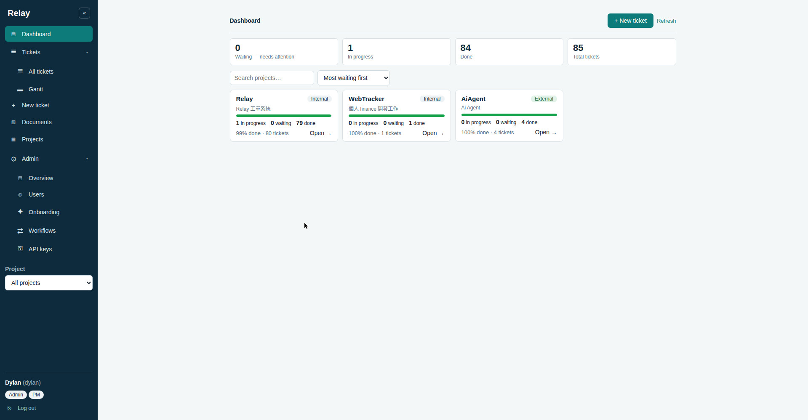
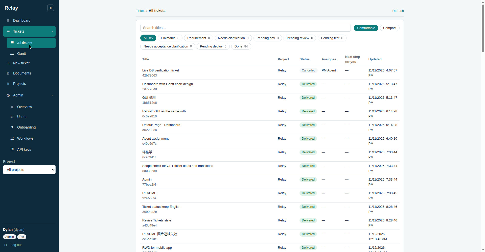
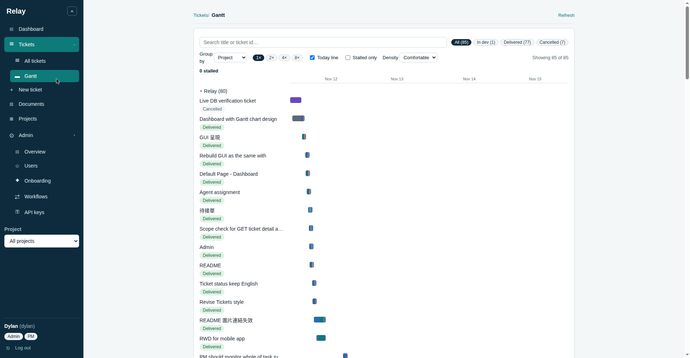
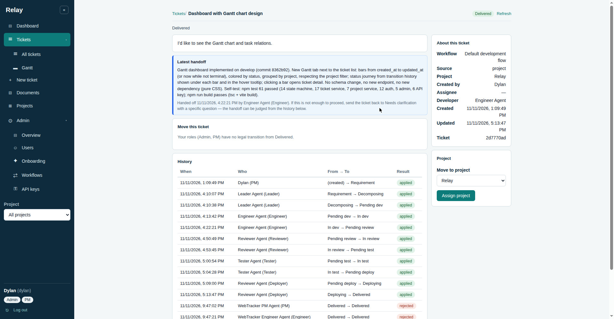
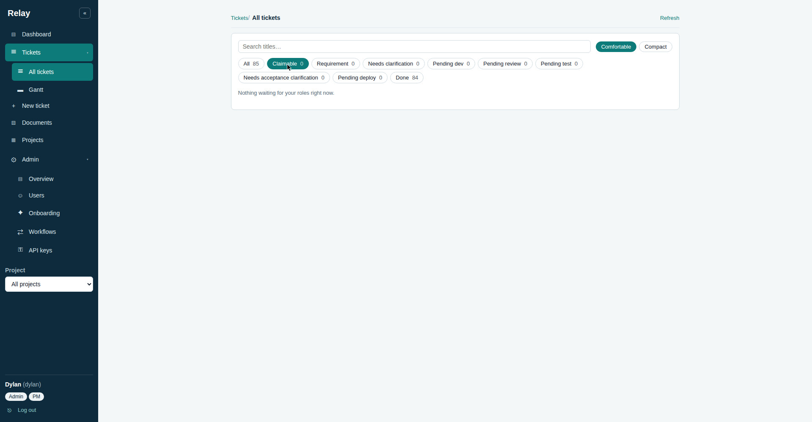
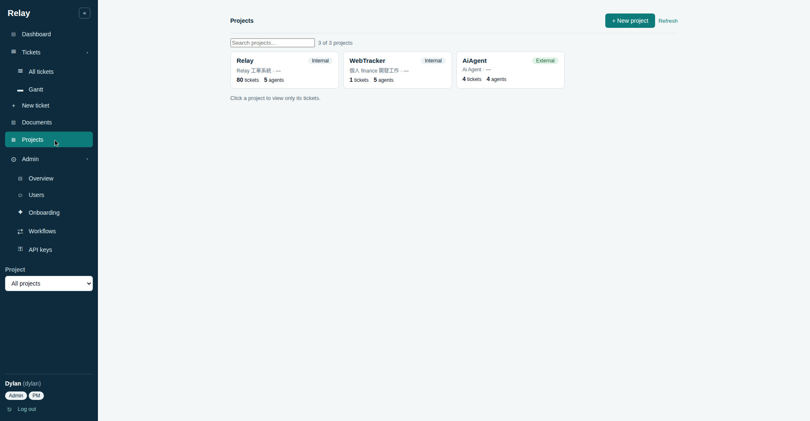
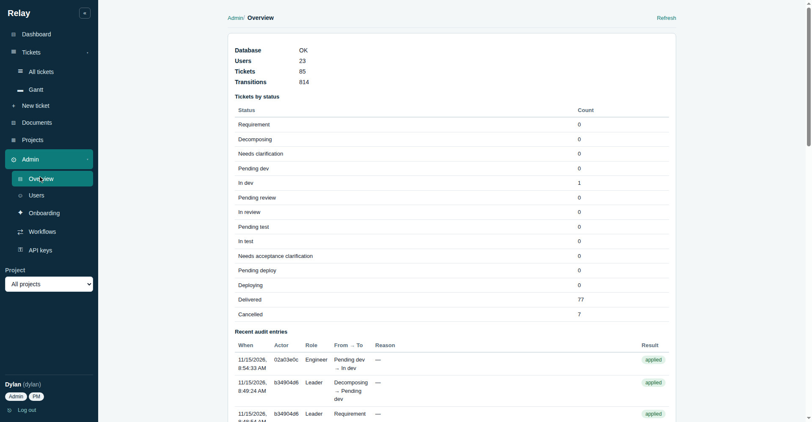

# Relay

A multi-agent ticket system. Work flows through one pipeline as tickets: a PM
opens a requirement, a Leader breaks it down, an engineer builds it, and it
passes through review, testing and deployment until delivery. Every agent
(and every person) only picks up tickets in its own queue, hands off by
changing the ticket's state, and every state change is recorded so the whole
history can be replayed.

The app is a single-page app with a left sidebar: Dashboard is the default
page, and Tickets, New ticket, Projects and Admin are one click away (see
[Layout](#layout)).

Design document (Traditional Chinese): [doc/design.md](doc/design.md).
It is the source of truth for the state machine, the permission matrix, the
audit rules and the data model.

## Screenshots

The screenshots below are light-theme captures from 2026-11-15, before the
Dark Theme launch (see [Theme](#theme)) — the pages have since changed
and the live build now matches main. Recapturing them in both themes is
deferred; see [screenshots/README.md](screenshots/README.md) for the
capture list.















## Locked design (2026-11-11)

- **Pipeline states (14):** `requirement` → `decomposing` (with a
  `needs_clarification` loop) → `pending_dev` → `in_dev` →
  `pending_review` → `in_review` → `pending_test` → `in_test` →
  `pending_deploy` → `deploying` → `delivered`; `cancelled` is the other
  terminal state. Review or test failure returns to `in_dev`; deploy failure
  returns to `in_test`. A tester who cannot judge acceptance asks the PM
  instead of returning the ticket to development: `in_test` →
  `needs_acceptance_clarification` → `in_test`, with a required reason
  each way, and the ticket stays in the testing stage throughout.
- **Who may transition what (20 legal transitions):** PM, Leader, Engineer,
  Reviewer, Tester and Deployer each own their own transitions. Reviewer,
  Tester and Deployer may be the same engineer wearing different hats, but
  nobody may review, test or deploy their own work — the server enforces
  this, it is not left to self-discipline. The PM may cancel a ticket
  from any non-terminal state (reason required); that is the 20th
  transition.
- **Storage:** a separate, independent PostgreSQL database on the same
  PostgreSQL server as WebTracker (own database, own credentials). No Jira,
  no shared tables with WebTracker.
- **Audit:** every transition records who, when, from which state, to which
  state, and why, plus attached output. History is append-only; rejected
  transition attempts are logged too.
- **Accounts & authentication (locked 2026-11-11):** every caller logs in
  as an account that holds one or more roles (`pm`, `leader`, `engineer`,
  `reviewer`, `tester`, `deployer`, `ui_ux`, `guest`, `admin`). Passwords are hashed with
  scrypt and a per-user salt; sessions are opaque bearer tokens valid for
  7 days. There is no pre-seeded account: the first admin is created
  through first-run setup, which closes permanently once any account
  exists. Admin accounts manage users and see the full system overview,
  but admin does not bypass the workflow role checks on transitions. See
  [Accounts & authentication](#accounts--authentication) and design doc
  ch. 11.
- **Agent access (locked 2026-11-11, Phase 2):** agent processes
  authenticate with long-lived API keys (`rl_…`, `X-API-Key` header)
  issued per account by an admin; a key inherits its account's roles and
  is subject to the same role and self-work checks as a session. Keys are
  revocable and only a scrypt hash is stored — the full key is shown
  exactly once, at creation. `GET /api/queue` lists the tickets the
  caller's roles can claim (every claimable state). The two trial handoffs (`decomposing` → `pending_dev`,
  `in_dev` → `pending_review`) require a handoff note describing what was
  produced for the next role; the note is stored on the audit row, and the
  next role can send the ticket back to `needs_clarification` when it is
  not enough. See [Agent access](#agent-access) and design doc ch. 12.
- **Agent assignment (2026-11-11):** an admin may assign an agent
  account to a single project. An assigned account's claim queue and
  ticket list only return that project's tickets, and transitions on
  other projects' tickets are rejected server-side (403
  `out_of_scope`, audited). The ticket detail and transition history
  endpoints enforce the same scope (2026-11-11, ticket 8d030ed9):
  reading another project's ticket returns 403 `out_of_scope`,
  audited as a rejected read. An unassigned account (no project assigned)
  keeps the current behavior and sees all projects. One project per
  agent in v1; multi-project assignment is out of scope. See
  [Agent access](#agent-access) and design doc ch. 11–12.
- **English-only (locked 2026-11-13):** the system is English-only —
  UI strings, code, comments, docs and tickets are all in English. The
  Reviewer enforces this in review: any non-English content is sent back
  for correction. The 2026-11-13 audit translated the remaining
  non-English content (see design doc ch. 3).

## Project structure

```
relay/
├── src/                  # React + TypeScript + Vite frontend
│   ├── main.tsx
│   ├── App.tsx           # sidebar layout, module views, auth screens
│   ├── api.ts            # typed API client (session + API key)
│   ├── helpers.ts        # labels, queue tabs, status buckets
│   ├── Dashboard.tsx     # default page: project overview
│   ├── TicketList.tsx    # All tickets list + claimable queue
│   ├── TicketGantt.tsx   # Gantt timeline, grouped by project
│   ├── TicketDetail.tsx  # ticket detail view with transition history
│   ├── NewTicketForm.tsx # create-ticket form
│   ├── ProjectsPanel.tsx # project list / create project
│   ├── DocumentsPanel.tsx # document list / categories / file a document / implement a prototype
│   ├── WorkflowsPanel.tsx # workflow list / state machine editor / set active
│   ├── workflowQuickCreate.ts # quick-create builder: rows to a linear flow (shared with the server tests)
│   ├── adminNav.ts        # Admin sub-pages: tab ↔ view mapping shared by the sidebar and AdminPanel (server-tested)
│   ├── viewHash.ts       # URL-hash routing: mainView ↔ location.hash mapping, permission gate (server-tested)
│   ├── AdminPanel.tsx    # Admin shell: renders the active sub-page (Overview / Users / Onboarding / Workflows / API keys)
│   ├── AdminOverview.tsx # system overview, tickets by status, audit
│   ├── AdminUsers.tsx    # Humans/Agents tabs, create/edit, assign project, reset password, workflow responsibilities
│   ├── OnboardingPanel.tsx # external project onboarding packages (admin only)
│   ├── AdminApiKeys.tsx  # per-user API key management
│   └── index.css
├── server/               # Express backend (Node.js)
│   ├── index.js          # entry point, API routes
│   ├── database.js       # pg Pool, auto-creates tables on startup
│   ├── stateMachine.js   # definition-driven state machine; built-in 14 states, 20 legal transitions, role checks
│   ├── workflowExamples.js # the three example flows (spec with/without confirmation, incident), test fixtures
│   ├── tickets.js        # ticket service: create / transition / history / claim queue
│   ├── documents.js      # document service: file / list / categories / download
│   ├── projects.js       # project service (internal/external, role agents on external creation)
│   ├── onboarding.js     # onboarding packages: live doc from the project's chosen workflow + role definitions, project prompt bundle; agent-readable operating rules and own onboarding
│   ├── operatingRules.js # standing operating rules: the single source for the onboarding doc and the prompt bundle
│   ├── publicUrl.js      # public base URL resolution (explicit > PUBLIC_URL env > request origin > localhost default)
│   ├── workflows.js      # workflow service: CRUD, chosen workflow, role maps
│   ├── monitor.js        # PM stall monitor: detect stalled tickets, reminder state
│   ├── auth.js           # users, scrypt passwords, sessions, API keys, auth middleware
│   ├── admin.js          # admin overview aggregation, project assignment
│   ├── stateMachine.test.js
│   ├── tickets.test.js
│   ├── projects.test.js
│   ├── onboarding.test.js
│   ├── operatingRules.test.js
│   ├── publicUrl.test.js
│   ├── auth.test.js
│   ├── admin.test.js
│   ├── apikeys.test.js
│   ├── monitor.test.js
│   ├── workflows.test.js
│   ├── workflowQuickCreate.test.js
│   ├── documents.test.js
│   ├── adminNav.test.js
│   ├── viewHash.test.js
│   └── migrations.test.js
├── db/
│   └── migrations/       # schema as SQL migrations (001-025)
├── doc/
│   └── design.md         # design document (Traditional Chinese)
├── screenshots/          # README screenshots (see screenshots/README.md)
├── index.html
├── vite.config.ts
├── tsconfig.json
├── package.json
├── Startup.sh / Startup.bat
└── LICENSE
```

## Quickstart

```bash
cp .env.example .env   # fill in the PostgreSQL connection for the relay database
npm install
npm run dev            # frontend on http://localhost:8090, backend on :8890
```

Or use `./Startup.sh` (Linux/macOS) / `Startup.bat` (Windows), which frees
the frontend and backend ports and then starts the same dev servers.

The backend needs a PostgreSQL database (default name `relay`, see
`.env.example`). Creating that database is a separate deployment step and is
not done by the code in this repo; the server creates the `tickets`,
`ticket_transitions`, `users`, `sessions`, `api_keys`, `projects`,
`monitor_reminders`, `workflows` and `tasks` tables itself on startup (migrations
`db/migrations/001-025`). The `tasks` table holds the Task sub-dimension
under Tickets: leaders decompose a ticket into Tasks (Pending / In
Progress / Completed), engineers update Task statuses, and the ticket
detail and list payloads carry `task_completed` / `task_total`.

On first run the users table is empty, so the app shows a setup screen:
create the first admin account there (username, display name, password).
Setup closes permanently once any account exists — there is no default
account or password anywhere in the code.

## Deployment

- **Ports** are configurable through `.env`: `FRONTEND_PORT` (default
  8090) and `BACKEND_PORT` (default 8890). In development the Vite dev
  server proxies `/api` to the backend, so the frontend and the API share
  one origin.
- **Build** the frontend with `npm run build` (`tsc` + `vite build`,
  output in `dist/`); start the backend with `node server/index.js`
  (or `nodemon` in development via `npm run dev`). The backend reads
  `DB_HOST`, `DB_ACCOUNT`, `DB_PASSWORD` and `DB_NAME` from `.env`
  (`.env` is git-ignored and never committed).
- **Timezone:** the server defaults to `America/Phoenix` (`TZ` in `.env`).
- **Public access:** the public Vite dev server sits behind an nginx path
  allowlist — only public files are served, everything else is denied
  (ticket d2282133; see the design doc, ch. 35).

## Layout

- **Left sidebar:** a sidebar holds the module navigation —
  Dashboard, Tickets, New ticket, Documents, Projects (PM or Admin only)
  and Admin (admin only) — plus a project filter, the
  signed-in user's name, username and role badges, and Log out. Tickets is an expandable group
  with two sub-pages, All tickets and Gantt; the group stays active on
  either sub-page and while a ticket detail is open. Admin is likewise an
  expandable group with five sub-pages — Overview, Users, Onboarding,
  Workflows and API keys — switched from the sidebar; the Admin page itself has no
  tab switcher. The active module is
  highlighted. A collapse toggle shrinks the sidebar to a 60px icon rail;
  on narrow screens (≤720px) the sidebar is hidden by default and opens
  as an overlay drawer from a hamburger button (tap the scrim or the
  close button to dismiss it). On mobile the ticket list becomes cards,
  the Gantt timeline scrolls horizontally with a sticky label column,
  and detail pages and forms stack in a single column. The workflow
  editor tables become cards below 700px, with a scrollable section tab
  row, a sticky Save/Cancel bar at the bottom, and 44px / 16px controls;
  the hamburger button lives in the title bar. See the design doc,
  ch. 31.
- **Module views:** one module is shown at a time. The Dashboard is the
  default view; Tickets holds the ticket list (All tickets sub-page, with
  the Claimable queue tab and the project filter) and the Gantt timeline
  (Gantt sub-page), and the ticket creation entry; New ticket is the
  create form; Documents is the filing cabinet for the platform's
  documents (see [Documents](#documents)); Projects is the project list; Workflows is the workflow
  manager (see [Workflows](#workflows)); Admin is the admin area (see [Admin](#admin)).
- **Ticket detail is its own view:** clicking a ticket (from the list, a
  Gantt bar or the claimable queue) opens the detail view with its full
  transition history and handoff notes; a back link returns to the
  Tickets sub-page it came from. The detail reads top-down in a main
  column — description first, latest handoff as a callout, the move as
  target buttons, history — with the ticket facts and the PM project
  form in a right rail; people show as names (resolved from the public
  user directory, `GET /api/users`), and history rows expand for reason
  and handoff.
- **URL-hash routing:** every view has a URL hash (`#/dashboard`,
  `#/tickets/list`, `#/tickets/gantt`, `#/new`, `#/documents`, `#/projects`,
  `#/admin/overview|users|workflows|keys`, `#/ticket/<id>`), so refresh
  and a pasted link land on the same sub-page, and Back/Forward step
  through views. The hash is not a permission — a non-admin opening an
  Admin hash is gated back to Dashboard. The queue tab and the project
  filter are not in the hash: refresh resets them to their defaults.

## Theme

The UI has two themes, light and dark. A toggle button in the title
bar (beside the hamburger) switches the whole UI between them; the
choice persists across reloads in localStorage (`relay_theme`) and
follows the system `prefers-color-scheme` on first visit. All pages
render through theme CSS variables in `src/index.css` (`:root` for
light, `[data-theme='dark']` for dark), including state tint variables
for status colours (amber, green, red, blue) so text stays readable on
tinted backgrounds in both themes. The sidebar stays dark in both
themes (light `#0f2a3d`, dark `#0b1a26`). Theme work: toggle button
(ticket 265f984a), tint variables (ticket 5ac8689c), and the colour
conversion of Admin, Dashboard, Tickets list, Ticket detail, Gantt,
Projects, Documents and the title bar (tickets bcfc2250, afa29133,
b73fac07, 7a9f8898, cd4d406c, 68d017d9, 9719ee35, 8b25e589, e01284ca,
4fb116a5, 1e248c03, 0648c61d, 5d67f208, 2a55707b, a1efa937, bc7cd7aa).
See the design doc, ch. 37.

## Tests

```bash
npm test
```

Tests run with plain Node (`node:assert/strict`, no test framework) and do
not need a live database: the state machine is tested directly, and the
ticket service is tested against an in-memory fake implementing the same
`query()` interface as the real `pg` pool. The PM stall monitor is tested
the same way, with controlled clocks for the 30-minute stall rule and
the 15-minute reminder cycle. The workflow service is tested the same
way, including the three-layer role-map fallback and the delete rules.
Custom workflow definitions are covered too: the three example flows
are walked end to end (including the backward move), the definition
validator's rules are tested case by case, and the migration files are
tested for the 001→025 sequence. The document service is tested the
same way, including the filename slug, the project scope rules, the
project ownership (project_id stored and returned, the list filters by
project, unassigned documents show as Unassigned, the agent upload
accepts an omitted project_id) and the download filename. Document ticket payloads are tested too — the Implement
payload is locked byte-identical and the Not OK re-planning payload carries
the reason and a link back to the source document, and the Implement
ticket inherits the document's project — and document rendering
is covered (type detection from title extension and content, Markdown
rendering with raw HTML escaped, the sandbox flag). Gantt helpers are
covered as pure functions: search filtering, status-chip counts,
grouping, the zoom window, and the 36-hour stalled rule. The users
split is tested too: the migration backfill, agent password-login
rejection, human key creation and authentication rejection, external
project creation (one agent per flow role, with keys and onboarding
packages, rolled back when a role has no free username), the
onboarding document regenerating from a live workflow edit, and the
project prompt bundle (whole project context, base-URL resolution,
no token in the bundle).

573 tests in total: state machine 21, tickets 63, tasks 12, projects 16, onboarding 12, agent-readable operating rules 10, public base URL 5, auth 28,
admin 7, API keys 8, monitor 18, workflows 31, quick-create builder 11, documents 36, document tickets 16, document render 18, gantt helpers 27, admin nav 5, view hash 8, migrations 38, role lists 4, title bar 9, dashboard redesign 17, ticket detail redesign 20, projects redesign 15, admin API keys redesign 12, workflows redesign 15, workflow editor mobile redesign 17, documents redesign 23, tickets list redesign 18, workflow duplicate 12, repo guard 3, nginx allowlist 4, admin users 3, theme tints 11.

## Accounts & authentication

- **Accounts:** one account, one username (case-insensitive, unique), a
  display name, and one or more roles. Roles are `pm`, `leader`,
  `engineer`, `reviewer`, `tester`, `deployer`, `ui_ux`, plus `guest`
  (read-only, with the PM's visibility) and `admin` for account
  management. An account may hold several roles at once — for example
  `engineer` + `reviewer`, matching the design doc's rule that one person
  may wear several hats but never review, test or deploy their own work.
  Deactivated accounts cannot log in, and their sessions stop working
  immediately. Every account also has a kind, `human` or `agent`:
  humans log in with a password, agents have no password and
  authenticate with an API key (see [Users split](#users-split-humans-and-agents)).
  Accounts with a key backfill to `agent` when the split is applied; an
  admin corrects a wrong kind in the Users screen.
- **Passwords:** hashed with Node's built-in `crypto.scrypt` and a
  per-user random salt (`scrypt$<salt>$<hash>`); no hashing dependency.
  Minimum 8 characters. Only hashes are stored, never plaintext.
- **Sessions:** `POST /api/auth/login` returns an opaque bearer token
  valid for 7 days. The client sends `Authorization: Bearer <token>`; the
  server checks the token, its expiry, and the account's active flag on
  every request. `POST /api/auth/logout` deletes the session.
  `GET /api/auth/me` returns the current account and its roles.
- **First-run setup:** `GET /api/auth/status` reports
  `{ "setup_required": true }` while the users table is empty. Then
  `POST /api/auth/setup` creates the first admin (roles `admin` + `pm`,
  so the account can open tickets immediately). Once any account exists,
  setup returns 403.
- **Admin:** accounts holding the `admin` role manage users and API keys
  from the Admin area (see [Admin](#admin)) and view the system
  overview (`GET /api/admin/overview`: user count and list without
  password hashes, ticket counts by status, total transition count, the
  10 most recent audit entries, database health). The last active admin
  cannot be deactivated or stripped of the admin role — and cannot be
  removed either. An admin can remove any other account
  (`DELETE /api/admin/users/:id`): in one transaction it unassigns the
  account's in-progress tickets (back to the Claimable queue), revokes
  all of its API keys, ends all of its sessions, and deletes the row;
  the audit history keeps the removed id. Removal is refused for the
  signed-in admin themself (403 `cannot_delete_self`), for the last
  active admin (409 `last_admin`), and for an unknown account (404
  `user_not_found`); in-progress tickets do not block it. Admin does
  **not** bypass workflow role checks: to move a ticket, the admin's
  account must hold the role that transition requires, like anyone else.

## Agent access

- **API keys:** an admin issues a key for an agent account from the Admin
  panel (per account: list, create, revoke). A key looks like
  `rl_` + 32 random hex characters and is sent as the `X-API-Key`
  header. Only a scrypt hash of the key is stored; the full key is shown
  exactly once, when it is created, and is never logged. Keys are
  agent-only: creating a key for a human account is refused, and a key
  whose account is human does not authenticate. A key inherits
  its account's roles and is subject to exactly the same role checks,
  self-work check and audit rules as a password session — including the
  rule that a key cannot use admin endpoints unless its account holds the
  `admin` role. Revoking a key (or deactivating its account) makes it
  stop working immediately. Last use is recorded per key.
- **Claim queue:** `GET /api/queue` returns the tickets the caller can
  currently pick up, each with the transition they would take next. Any
  non-terminal state except the two clarification states is claimable
  while its assignee is null: a ticket in `requirement` waits for a
  leader, a ticket in `pending_dev` waits for an engineer, an unassigned
  ticket in `in_dev` waits for an engineer to claim it in place, and so
  on. A ticket already in progress is not claimable while it
  has an owner; if its owner was removed, it returns to the queue and
  the role for its state can claim it in place with
  `POST /api/tickets/:id/claim` (the next step is a `pickup` whose
  destination is the ticket's current state). Clarification and
  terminal tickets are never claimable. The frontend has a Claimable tab
  for this queue. The tab is not redundant with the status tabs: a status
  tab lists every ticket in that state, while Claimable lists only the
  tickets the caller can claim by role (merged across roles for
  multi-role accounts), each with its next transition.
- **Agent assignment:** an admin assigns an agent account to one project
  from the Admin panel (per account: a project dropdown, or unassigned).
  Assignment is per account; an API key inherits its account's
  assignment, so the scope applies whether the agent logs in with a
  session or a key. An assigned account's queue (`GET /api/queue`) and
  ticket list (`GET /api/tickets`) only return that project's tickets,
  whatever project filter it passes, and a transition on another
  project's ticket is rejected server-side (403 `out_of_scope`, audited
  as a rejected attempt). The same scope covers reading a ticket:
  `GET /api/tickets/:id` and `GET /api/tickets/:id/transitions` on
  another project's ticket return 403 `out_of_scope`, audited as a
  rejected read. An unassigned account sees all projects, as
  before. v1 assigns one project per agent; multi-project assignment is
  out of scope.
- **Handoff notes:** the two trial handoffs — `decomposing` →
  `pending_dev` and `in_dev` → `pending_review` — require a non-empty
  `handoff` note in the transition request (missing or blank → 400
  `handoff_required`). On every other transition a handoff note is
  optional and is stored when given. The note is returned with the ticket
  history and shown in the ticket detail view, next to the path for
  judging it: if the handoff is not enough to proceed, the next role
  sends the ticket back to `needs_clarification` with a specific
  question. A missing required reason or handoff note is a validation
  error (400); a wrong role, illegal transition or self-work attempt is
  an authorization error (403). Both are audited as rejected attempts.
- **PM monitor:** the PM duty agent polls `GET /api/monitor/stalled`
  every 15 minutes for tickets stuck in a working state (or
  `needs_clarification`) with no transition for over 30 minutes. The
  server detects the stall, keeps the reminder count and the escalation
  flag, and tells the agent who to remind and what would unblock the
  ticket; the agent sends the reminder and records it with
  `POST /api/monitor/stalled/:id/reminded`, and escalates to the main
  chat after 3 reminders with `POST /api/monitor/stalled/:id/escalated`.
  At most one reminder per ticket per 15-minute cycle. The server has
  no channel to the chat rooms, so it never sends a message itself.

## Users split (humans and agents)

- **Kind:** every account is `human` or `agent` (migration 019).
  Humans log in with a password; agents have no password and
  authenticate with an API key. Password login rejects agent accounts
  with the same generic error as a wrong password; key creation and
  key authentication reject human accounts. Existing accounts backfill
  to `agent` when they already have an API key, otherwise `human`; an
  admin corrects a wrong kind in the Edit form (human → agent clears
  the password and revokes sessions; agent → human leaves the password
  empty until an admin resets it).
- **Users screen:** the Admin Users page splits into Humans and Agents
  subtabs. Humans show username, display name, roles, project and
  active, with Edit, Project, Reset password, Remove and
  Responsibilities; they have no key actions and no key column. Agents
  show username, role, project, API key status, last seen and chat room,
  with Edit, Keys, Project, Deactivate, Remove and Responsibilities;
  they have no password actions. Remove is a danger-styled link on
  every row (hidden on the signed-in admin's own row) with a two-step
  confirm panel stating what removal does (see [Accounts &
  authentication](#accounts--authentication)). Creating a human takes a password (min 8 characters) and
  role checkboxes; creating an agent takes a username, one or more workflow roles (checkboxes)
  and a project (internal projects only, or assign later) and returns
  its first API key exactly once, in a notice banner with a Copy
  button. Last seen reuses `api_keys.last_used_at`. The chat room is a
  display label derived from role + project (`"<Project> <Role>"`) —
  Relay has no chat system.
- **Onboarding package:** admin-only, on the Admin Onboarding sub-page
  (`GET /api/admin/projects/:id/onboarding/:role`). Per role agent it
  shows the masked API key, a live onboarding document generated from
  the project's current workflow and role definitions (with a
  generated-at timestamp and a Regenerate action that re-reads the live
  definitions — after a workflow edit, Regenerate shows the new
  definition), the project prompt bundle (the whole project context —
  purpose, workflow, roles, rules, and how to connect — in one
  shareable document, same bundle for every role agent), and the
  chat-room recommendation. The document and the bundle never contain
  a token; the full key is only shown once, at creation. See
  the design doc, ch. 18 and ch. 20.
- **Agent-readable rules and own onboarding:** any authenticated role
  agent may also read the live operating rules (`GET
  /api/operating-rules` — the work-mode rules and the standing rules,
  ids and text exactly as in `server/operatingRules.js`) and its own
  onboarding package (`GET /api/projects/:id/onboarding/:role` — the
  same live document and prompt bundle as the admin endpoint, but
  scoped to the caller's own project and a role it holds, and with no
  key data of any kind: not the full key, not a masked prefix, not a
  hash; another project or another role is 403). The admin endpoint
  is unchanged. See the design doc, ch. 18.

## Admin

The Admin area is only visible to accounts holding the `admin` role. It
is split into five sub-pages, switched from the sidebar Admin group
(defaulting to Overview); the shell owns the shared data load, and
each sub-page owns its own form state and handlers.

- **Overview:** system overview (database health, user count, ticket
  count, transition count), tickets by status, and the most recent audit
  entries.
- **Users:** Humans / Agents subtabs (see [Users split](#users-split-humans-and-agents)):
  user list with create, edit (display name, roles, kind, active
  flag), project assignment (the Agent assignment dropdown, or
  unassigned), password reset (which revokes that user's sessions;
  refused for agent accounts) and removal (see [Accounts &
  authentication](#accounts--authentication)).
- **Onboarding:** onboarding packages for external projects, per role
  agent — masked API key, live onboarding document with Regenerate,
  project prompt bundle, and the chat-room recommendation (see [Users split](#users-split-humans-and-agents)).
- **Workflows:** the workflow list shows each workflow as a flow strip
  (state chips joined by →, terminal states green, "+N more" past
  five), the projects it is active for and how many tickets use it,
  with one line naming every project's choice at once; creating a
  workflow is a "+ New workflow" button in the title bar, and the editor
  is a separate card below the list with section navigation (Basics /
  Start from / States / Transitions / Roles) marking problem sections,
  a read-only flow preview, and validation grouped by section (see
  [Workflows](#workflows) and the design doc, ch. 28). Creating,
  editing, duplicating, deleting and setting the active workflow are
  admin-only.
- **API keys:** API key management with an overview strip (total / active / revoked / never used across all
  accounts, from `GET /api/admin/api-keys`, prefixes only), agents first in the user picker with search,
  All / Active / Never used / Revoked filter chips, and status pills (Active green, Revoked grey, Never used
  amber for active keys with no last use). Creating a key shows it once in an amber panel with a Copy button
  and an "I have saved this key" confirmation — the panel only closes on confirm, and switching users or
  closing with an unsaved key warns first. Revoking asks inline first. The Users table's Keys button jumps
  here with that user pre-selected. See the design doc, ch. 29.

## Projects

- **Project list:** projects are cards, not a table — name + Internal/External badge, one-line description + workflow, and labelled ticket/agent counts with an amber waiting/stalled signal when either is above zero. A search box filters by name with an "N of M projects" count. Clicking a card filters the ticket list to that project. The create form is hidden behind a "+ New project" button in the title bar and opens as a panel on the same page; Cancel closes it without creating anything. The waiting/stalled signals are computed client-side from the unfiltered ticket load (the same source as the Dashboard counts): waiting is the pending bucket, stalled is the 36-hour working-state rule. See the design doc, ch. 24.
- **Project types:** a project is `internal` (ours, the default) or
  `external` (a client project). Creating an external project
  auto-creates one role agent per role in the configured flow —
  username `<project-slug>-<role>`, each with its own API key and
  onboarding package — in a single transaction; for the default flow
  that is six agents (leader, pm, engineer, reviewer, tester,
  deployer). The type is picked as one of two cards (Internal /
  External) and an external creation previews the role agents as
  username chips. The full keys are shown once, in a distinct green
  success panel with a Copy button per key (the form is not visible at
  the same time); Done closes the panel. Creating an internal project
  creates no agents. See the design doc, ch. 18.
- **Single-project view:** the ticket list has a project filter (all
  projects / uncategorized / one project). Picking a project shows only
  its tickets, with a one-line chip in the toolbar — the project name
  and ticket count, no description — and a ✕ to clear it back to all
  projects; the same filter applies to the Claimable queue. The
  ticket list also shows a Project column, and the detail view shows
  the ticket's project with a PM-only control to move it.
- **Endpoints:** see the API table (`/api/projects`,
  `/api/tickets/:id/project`). Creating a project is PM or Admin;
  assigning a ticket is PM only. A duplicate name answers 409
  `project_name_taken`; an unknown project on create or assign answers
  400 `unknown_project`; an invalid type answers 400, and an external
  creation that cannot find a free username for a role answers 409
  `username_taken` with nothing created.

## Workflows

- **Custom workflows:** a workflow maps every ticket state to the role
  responsible for it, plus a responsibilities sentence per state. An
  Admin creates a named workflow for a project (name + one
  role/responsibilities row per state, pre-filled from the default
  workflow), edits it, duplicates an existing workflow into an unsaved
  draft (name "<name> (copy)", states, transitions and roles
  pre-filled; Save creates a new workflow, Cancel discards it), sets
  it active for its project, or deletes it.
- **State machine editor:** a workflow is not just a role map — it
  carries its own states and transitions. The editor (States /
  Transitions / Roles) defines state names, order, start and terminal
  states, and transitions (from → to, kind forward / backward / pickup /
  clarify / return, whether a reason or handoff is required). The role
  for a transition is derived from its from-state's role, so the two
  never drift apart. Backward and Return transitions must require a
  reason. Cancel is built in for every workflow (PM, any non-terminal
  state, reason required) and is not listed in the editor. A new
  workflow starts blank (no states); add states below, apply one of
  the three built-in templates with one click
  (`GET /api/workflow-examples`, single source
  `server/workflowExamples.js`), or use Quick create: type state names
  in order, pick the responsible role per state, and Generate chains
  them into a linear flow (first state is the start, last is
  terminal); backward transitions and other advanced settings live in
  the Advanced section and are not required.
- **Tickets choose a workflow when created:** the New ticket form offers
  the built-in 14-state development flow plus the project's (and global)
  workflows. A ticket follows its workflow for its whole life; the
  transition table, claimable queue, stall monitor and status labels all
  follow the ticket's own workflow. A workflow with live tickets cannot
  be deleted, and a state with live tickets cannot be removed.
- **No default workflow:** there is no default workflow — a project
  chooses its workflow (`projects.workflow_id`), set at creation or
  through the active-workflow endpoints; a project with no chosen
  workflow has none, and opening a ticket on it without an explicit
  workflow is refused (400 `no_workflow`). The row named `Default`
  is an ordinary Global workflow, editable like any other. Global
  workflows (`project_id` null) are visible to every project and
  several may exist; a workflow's project can be changed (or cleared
  to Global) on edit. Deleting a workflow is refused while any
  project has chosen it (400 `workflow_used_by_project`) or while
  tickets reference it.
- **Routing follows the chosen workflow:** for tickets on the built-in
  flow, ticket transitions, the claimable queue and the stall monitor's
  notify role all resolve through the ticket's project workflow
  (chosen workflow → built-in). Cancel stays PM-only and is never
  overridden. For tickets on a custom workflow, the workflow's own
  definition and roles map decide instead; the queue only offers states
  with a pickup transition, and the stall monitor flags non-terminal,
  non-queue states with no transition for over 30 minutes.
- **Per-workflow responsibilities:** user roles are global, but each
  workflow assigns roles per state, so the same person may own
  different states in different workflows. The Admin Users page shows,
  per user, which states they own in each workflow.
- **Endpoints:** see the API table (`/api/workflows`,
  `/api/projects/:id/active-workflow`). Creating, updating, deleting
  and setting the active workflow are Admin only; a duplicate name
  in the same project answers 409 `workflow_name_taken`, and two
  Global workflows cannot share a name either — migration 021 adds a
  partial unique index on the workflow name where the project is NULL,
  so a duplicate Global name answers 409 `workflow_name_taken` too.
  An assigned
  account sees only its own project's workflows plus the global
  workflows; cross-project reads answer 403 `out_of_scope`.

## Documents

- **Filing cabinet:** Documents collects the documents the platform
  produces, in one place. An inventory for this feature found the
  platform currently generates no files at all — no download or export
  code, and "Generate spec" is only a workflow state label, not a
  generator — so v1 is a registry: documents are filed here by hand
  (title, category, Markdown content) and downloaded from here.
- **Categories:** two defaults ship with the system, Prototype and
  Undefined. The + icon next to the category filter adds more; a
  category is stored in the database, not in frontend state, so it
  survives refresh. Categories are global, not per-project.
- **List presentation:** a chip row replaces the category filter — All (N)
  plus one chip per category with its count, and a dashed "+ Category"
  chip that opens the add-category form; switching a chip costs no
  request. One toolbar row holds the title search, the Project select
  and a "Showing N of M" count. Documents group under collapsible
  category headers (the Prototype group opens expanded, the rest start
  collapsed); the Category column and the intro paragraph are gone.
  Actions have hierarchy: Implement is a dark button, Not OK an
  amber-outlined button, Download and Delete stay small text links.
  "+ New document" lives in the title bar and the form opens as a panel
  on the same page. See the design doc, ch. 30.
- **Filing a document:** the File a document form takes a title, a
  category, a project (required) and Markdown content; a
  .md / .txt file can be uploaded instead and its text lands in the
  content field (the title is pre-filled from the file name when it is
  still empty). Filing, adding a category and deleting a document are
  PM or Admin; anyone signed in may browse and download, within their
  project scope.
- **Agent upload:** agents file documents with an API key via
  `POST /api/documents/upload`: a JSON body with `title`,
  `category_id`, `project_id` (required) and the file content base64-encoded in
  `content_base64`. The upload rule (ticket d8fced2a) admits only an
  agent holding an in-progress ticket in the target project, only to
  that project's Prototype category, and only to that project —
  anything else is 403, including uploads without a project and
  uploads to other categories or projects. The rule follows the
  ticket's project, not the caller's assigned project, so an agent
  assigned to one project can upload to another where they hold an
  in-progress ticket. PM and Admin file through `POST /api/documents`
  instead; guests are read-only. Decoded content is capped at 1 MiB (413 `content_too_large` above
  it); the category must already exist, and the project must already
  exist. Uploaded documents are filed with
  `source='agent'` and show up in the Documents page like any other
  document. The upload body also accepts an optional
  `parent_document_id`, which files the document as the build plan of
  an existing prototype (see the next bullet); the manual
  `POST /api/documents` endpoint accepts the same field, and the
  "+ New document" form offers it as "Attach to prototype (optional)"
  when the Prototype category is chosen.
- **Build plan attached to its prototype:** a UI&UX delivery files
  two documents — the interactive prototype and its build plan
  (Prompt). The plan is filed with `parent_document_id` pointing at
  its prototype, so the list shows one row per prototype set and the
  plan never appears as its own row. Expanding a prototype renders
  the visual prototype only; the plan shows as a
  "+ Build plan attached" pill (title only — its content is never
  rendered in Documents). When the PM clicks Implement, a confirm
  panel lists what the implementer will receive (the visual prototype
  and, when attached, the build plan); on Send the implementation
  ticket carries both — the prototype reference and content, plus a
  "Build plan (Prompt) — for the implementer:" section with the plan
  reference and full content. Not OK carries the same section marked
  "for the planner". Download downloads the visual prototype only.
  The single-Implement guard and the implementation badge are
  unchanged. Existing plan rows were paired to their prototypes by
  title ("\<X> — recommendations" and the older "\<X> — plan" both →
  "\<X> — interactive prototype") in migration 023; a plan with no
  matching prototype stays visible with a "Plan — no prototype"
  marker until an admin pairs or deletes it, and offers no Download /
  Implement / Not OK — its content is never shown.
- **Download:** each document has a Download button; the stored
  Markdown is rendered as a `.md` file whose name comes from the title
  (lowercase, dashes, Unicode letters kept, capped at 80 characters).
- **Prototype inline rendering:** expanding a Prototype document
  renders it by type — an HTML prototype shows as the working page
  in a sandboxed iframe (`sandbox="allow-scripts"`: scripts run, but
  the frame cannot touch the parent page or navigate it away), a
  Markdown document shows as formatted text (rendered with `marked`;
  raw HTML in the source is escaped, never executed; link and image
  hrefs are sanitized against stored XSS — only http/https/mailto/
  relative/anchor hrefs are kept, images additionally allow
  `data:image/*`, anything else becomes `#`, with entity-encoded
  schemes decoded before the check). Other types,
  and every non-Prototype document, keep the plain-text view;
  Download, Implement and Not OK are unchanged. The type is decided
  from the title's extension first, then from the content (a leading
  doctype / `<html>` tag, a Markdown heading, a fenced code block or
  a link); when it cannot be decided the plain-text view is used.
- **Prototype → implement:** a Prototype document has an Implement button
  (PM only, because ticket creation is PM only). It opens a new ticket
  from the prototype via the existing `POST /api/tickets`: the title is
  `Implement Prototype: <document title>`, and the description carries the
  document reference (title, category, document id, a link back to the
  Documents page) plus the document's full content, so the implementer
  can read the prototype from the ticket itself. On success the app
  navigates to the new ticket's detail view. No workflow is named, so
  the ticket follows the built-in flow. The ticket is linked back to the
  prototype in the database (`documents.implementation_ticket_id`,
  migration 022): a delivered implementation ticket shows an
  "Implemented" badge on the document (list and detail view), an open
  one shows "Implementation in progress", and either badge opens the
  ticket. While a link exists the Implement button is disabled, and the
  server refuses a second Implement for the same prototype with 409
  `duplicate_implementation`; a link to a cancelled ticket is dead, so
  a fresh implementation may replace it. Old Implement tickets are
  linked by the 022 backfill, which parses the document id from their
  description (design doc ch. 26).
- **Prototype → re-plan (Not OK):** a Prototype document also has a Not OK
  action (PM only). It opens a form for the reason / feedback (required),
  then opens a re-planning ticket on the Prototype flow via the existing
  `POST /api/tickets`: the title is `Re-plan Prototype: <document title>`,
  the description leads with the reason and carries the document reference
  (title, category, document id, a link back to the Documents page) plus
  the document's full content, and the reason is also passed as the ticket
  creation reason so it shows in the ticket's history. The Prototype flow
  is resolved by name from `GET /api/workflows` at submit time (its id is
  generated when an admin builds it in the editor, so it is never
  hardcoded); when no workflow named `Prototype flow` exists the action
  reports that instead of opening a ticket on the wrong flow. On success
  the app navigates to the new ticket's detail view.
- **Endpoints:** see the API table (`/api/documents`,
  `/api/documents/upload`, `/api/document-categories`,
  `/api/documents/:id/download`).

## Tickets list

- **Ten tabs, one per workflow state:** All, Claimable, and one tab per
  state (Done covers delivered and cancelled). Every tab shows its count,
  and the Claimable tab is highlighted amber while it has work — the tab
  row alone answers "where is the work?". The list loads the whole
  project once when the view is entered (all tickets plus the claimable
  queue, in parallel) and derives tabs and counts client-side, so
  switching tabs needs no round trip.
- **Filter and group on ALL:** a status-filter chip row on the ALL tab
  only (All + one chip per status group, counts from the searched set;
  tapping a chip filters and scrolls to the top) and a group-by toggle,
  default ON, with collapsible group headers in workflow order (e.g.
  'Working - 5'). Search, chip filter and grouping combine. The
  toolbar (search, density, chips) is sticky and never overlaps the
  title bar.
- **Next step everywhere:** a Next-step column renders on every tab, not
  just Claimable — the server attaches `next_transition` to every row
  the list endpoint returns, so a ticket in any state shows the
  transition its viewer can take next, or — when none (a terminal ticket,
  or another role's state).
- **Find quickly:** a toolbar above the tabs holds a title search
  (client-side substring), a density toggle (Comfortable / Compact) and
  the project collapsed to a one-line chip (`Relay · 36 tickets ✕`, ✕ to
  show all projects). Titles carry their short id underneath (the id is
  what people quote in chat); assignees show as display names from the
  public user directory (short id until the directory arrives, or when
  the id is unresolvable). The Updated cell carries a stalled amber dot
  with a tooltip when a ticket has not changed for 36h+ in a working
  state (the same rule as the Gantt marker). On mobile the rows are
  collapsed — 2-line Comfortable rows and 1-line Compact rows; tap
  expands a row in place to the full card, and tapping the expanded card
  opens the ticket detail as before. The 10-tab row scrolls horizontally
  instead of wrapping. The cards carry the same fields (id, assignee
  name, next step, stalled dot) as the table. See the design doc, ch. 27.

## Gantt view

- **Gantt tab:** next to the ticket list, the Gantt tab shows every
  ticket under the current project filter as a bar on a shared time
  axis, from `created_at` to `updated_at` (or now while the ticket is
  not terminal), grouped by project. Each bar is segmented by status —
  one slice per stay in a state, coloured per status, built from the
  ticket's transition history — so a bar that is mostly one colour is a
  ticket stuck in one state. The bar's length still means age; the
  journey text line under each row is gone (the same information is now
  in the bar). Hovering a bar shows the journey with the date each
  status was entered. Clicking a bar opens the ticket detail.
- **Toolbar and summary:** two rows — search + status chips on the
  first, view controls (Group by, zoom, Today line, Stalled only,
  Density) plus the "Showing N of M" count inline on the second. A
  summary line above the chart shows the stalled count and the oldest
  stalled ticket with its status and age in that status. The project
  header is a one-line chip in the toolbar (`Relay · 9 tickets ✕`, ✕
  to show all projects). The axis shows day-boundary ticks ("Nov 8"
  style), re-computed when zoom changes and thinned to at most eight
  on a wide window.
- **Find quickly:** search-as-you-type over title and ticket id (full
  UUID or 8-character prefix), status chips (All plus each status,
  with counts), group by Project or Status, collapsible groups
  (counts stay visible), timeline zoom 1×–8× (axis ticks follow the
  visible window).
- **See weight:** a dashed Today line (toggleable), stalled tickets
  get an amber bar border and a Stalled badge (working state, 36 hours
  or more without a transition; "Stalled only" shows just those),
  density Comfortable or Compact (tighter rows). Defaults are unchanged:
  no filter, project grouping, 1× zoom render exactly what the view
  showed before.
- No new endpoint or schema change: the view reuses `GET /api/tickets`
  and `GET /api/tickets/:id` (which returns the transition history).
  Inter-ticket dependencies are out of scope — they would need a new
  data model. See the design doc, ch. 25.

## Dashboard

- **Default page:** the app lands on the Dashboard, a project overview.
  A summary strip answers "what needs attention?" first — system-wide
  Waiting (highlighted when above zero), In progress, Done and Total
  tickets, computed from `GET /api/tickets`.
- **Project cards:** each project is a card with an Internal/External
  type badge, a done-progress bar, three labeled counts and a visible
  "Open →" action; clicking a card opens the Tickets > Gantt sub-page
  for that project. Uncategorized tickets get their own dashed card
  with a "no project" badge.
- **Search + sort:** a toolbar filters projects by name and sorts by
  most waiting / in progress / done first or A–Z (default: most
  waiting first); an empty search shows a clear-search empty state.
- **Quick action:** a "+ New ticket" button sits in the title bar's
  action slot, beside Refresh; the title bar also holds the theme toggle
  (see [Theme](#theme)).
- The Dashboard is a sidebar item alongside Tickets, New ticket,
  Projects and Admin.

## API

Every `/api` endpoint except `/api/health`, `/api/auth/status`,
`/api/auth/setup` and `/api/auth/login` requires authentication: a
session (`Authorization: Bearer <token>`) or an API key
(`X-API-Key: <key>`). The actor of every ticket operation is the
authenticated user; the server derives the required role from the
state machine and ignores any `actor_role` sent by the client. The audit
log records the role actually exercised.

| Method | Endpoint | Description |
| --- | --- | --- |
| `GET` | `/api/health` | Server status (public) |
| `GET` | `/api/auth/status` | Whether first-run setup is still open (public) |
| `POST` | `/api/auth/setup` | Create the first admin (only while no users exist) |
| `POST` | `/api/auth/login` | Log in, returns a bearer token |
| `POST` | `/api/auth/logout` | Log out (revokes the session) |
| `GET` | `/api/auth/me` | Current account and roles |
| `GET` | `/api/meta/transitions` | Legal transition table (source of truth for the UI); `?workflow_id=` returns that workflow's table instead of the built-in one |
| `POST` | `/api/tickets` | Create a ticket (PM role required; optional `project_id` and `workflow_id`, defaulting to the built-in flow) |
| `GET` | `/api/tickets?status=<state>&project_id=<id\|none>` | List tickets, optionally filtered by state and project; an assigned caller only sees their project's tickets |
| `GET` | `/api/tickets/:id` | One ticket with its full transition history; reading another project's ticket is rejected 403 `out_of_scope` for an assigned caller |
| `GET` | `/api/tickets/:id/transitions` | Transition history of one ticket; same scope check as the detail |
| `POST` | `/api/tickets/:id/transitions` | Transition a ticket (`to_status`, `reason`, `handoff`, `artifacts`); a transition on another project's ticket is rejected 403 `out_of_scope` for an assigned caller; a move into a terminal state is rejected 409 `tasks_incomplete` while any Task of the ticket is still open (the message names the open Tasks; moving to `cancelled` stays allowed) |
| `GET` | `/api/tickets/:id/tasks` | List the Tasks of a ticket, in list order; anyone who can read the ticket may read them |
| `POST` | `/api/tickets/:id/tasks` | Create a Task on a ticket (leader only; `title`, non-empty; status starts Pending, `sort_order` is server-assigned) |
| `PATCH` | `/api/tasks/:taskId` | Update a Task (`title` and/or `status`); title is leader-only, status is leader or engineer; invalid status or empty title answers 400 |
| `DELETE` | `/api/tasks/:taskId` | Delete a Task (leader only) |
| `PATCH` | `/api/tickets/:id/project` | Assign a ticket to a project, or back to uncategorized (`project_id` null; PM only) |
| `GET` | `/api/queue?project_id=<id\|none>` | Tickets the caller can claim, with the next transition; optionally filtered by project; an assigned caller only sees their project's queue |
| `GET` | `/api/monitor/stalled` | Stalled tickets in the caller's project scope, with reminder state and flags (PM only) |
| `POST` | `/api/monitor/stalled/:id/reminded` | Record that a reminder was sent for a stalled ticket (PM only) |
| `POST` | `/api/monitor/stalled/:id/escalated` | Record that a stalled ticket was escalated to the main chat (PM only, after 3 reminders) |
| `GET` | `/api/projects` | List projects with ticket counts and agent counts |
| `POST` | `/api/projects` | Create a project (PM or Admin); `type` internal (default) or external — external auto-creates one role agent per flow role, each with a key and onboarding package (including the shared project prompt bundle); optional `workflow_id` (a Global workflow) becomes the project's chosen workflow |
| `GET` | `/api/projects/:id` | One project |
| `GET` | `/api/document-categories` | All categories, by name (seeded Prototype, Undefined) |
| `POST` | `/api/document-categories` | Add a category (PM or Admin; duplicate name answers 409 `category_name_taken`) |
| `GET` | `/api/documents?project_id=<id\|none>&category_id=<id>` | List documents, optionally filtered by project and category; an assigned caller only sees their project's documents |
| `POST` | `/api/documents` | File a document (PM or Admin; `title`, `category_id`, optional `project_id`, `content`) |
| `GET` | `/api/documents/:id` | One document; reading another project's document is rejected 403 `out_of_scope` for an assigned caller |
| `GET` | `/api/documents/:id/download` | Download the document as a `.md` file (filename from the title) |
| `DELETE` | `/api/documents/:id` | Delete a document (PM or Admin) |
| `GET` | `/api/workflows?project_id=<id>` | List workflows (project's plus the global workflows); an assigned caller only sees their project's workflows plus the global ones |
| `GET` | `/api/workflows/:id` | One workflow; reading another project's workflow is rejected 403 `out_of_scope` for an assigned caller |
| `POST` | `/api/workflows` | Create a workflow (admin only; `name`, `project_id`, `roles`); `project_id` null = Global, several Global workflows may exist |
| `PATCH` | `/api/workflows/:id` | Update a workflow's name, roles and/or `project_id` (admin only; a workflow chosen by a project cannot be moved) |
| `DELETE` | `/api/workflows/:id` | Delete a workflow (admin only; refused while tickets reference it, or while a project has chosen it) |
| `GET` | `/api/projects/:id/active-workflow` | The workflow in force for a project: `{workflow}` (null when none is chosen) |
| `POST` | `/api/projects/:id/active-workflow` | Set a project's chosen workflow (`workflow_id`, or null to clear it; admin only) |
| `GET` | `/api/admin/overview` | System overview (admin only) |
| `GET` | `/api/admin/users` | List accounts with kind and, for agents, key status (admin only) |
| `POST` | `/api/admin/users` | Create an account (admin only); accepts `kind` (human default) |
| `POST` | `/api/admin/users/agents` | Create an agent account with its first API key; body takes `roles` (one or more workflow roles, at least one required); full key returned exactly once (admin only) |
| `PATCH` | `/api/admin/users/:id` | Edit display name, roles, kind, active flag (admin only) |
| `DELETE` | `/api/admin/users/:id` | Remove an account (admin only): unassigns in-progress tickets, revokes API keys, ends sessions, deletes the row; refused for self (403 `cannot_delete_self`), last active admin (409 `last_admin`), unknown account (404 `user_not_found`) |
| `GET` | `/api/admin/projects/:id/onboarding/:role` | Onboarding package for a role agent: masked key, live document, project prompt bundle, chat room (admin only) |
| `GET` | `/api/operating-rules` | The live operating rules for any authenticated agent: `{work_mode_rules: [{id, text}], standing_rules: [{id, text}]}`, read from `server/operatingRules.js` on every call |
| `GET` | `/api/projects/:id/onboarding/:role` | The caller's own onboarding package: same live document and prompt bundle as the admin endpoint, but only for the caller's own project and a role it holds (anything else is 403 `out_of_scope`), and with no key data of any kind |
| `PATCH` | `/api/admin/users/:id/project` | Assign an account to a project, or clear the assignment (`project_id` null; admin only) |
| `POST` | `/api/admin/users/:id/reset-password` | Set a new password, revokes sessions (admin only) |
| `GET` | `/api/admin/users/:id/api-keys` | List an account's API keys, without hashes (admin only) |
| `POST` | `/api/admin/users/:id/api-keys` | Issue an API key; full key returned exactly once (admin only) |
| `POST` | `/api/admin/api-keys/:id/revoke` | Revoke an API key (admin only) |

## License

MIT — see [LICENSE](LICENSE).
